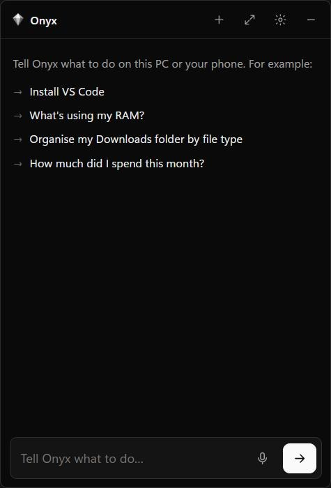

# Onyx

**An AI agent that operates your Windows PC and Android phone.** Tell it what you want,
by typing or by voice, and it does the work: installs software, organises files, fills
Excel sheets, tracks your spending from bank SMS, opens and controls apps on your PC and
phone, and runs jobs on a schedule. It runs on an open model on your own machine by default,
so it is free and private.



```
Install VS Code
Set up Python for me
What's using my RAM?
Organise my Downloads folder by file type
Add this PhonePe statement to my expense sheet
How much did I spend this month?
Open WhatsApp on my phone and read me the last message
Every Sunday at 8pm, tell me what I spent this week
```

Onyx lives as a small button in the bottom-right corner of the screen. Click it (or press
**Alt+Space**) and it opens into a compact chat; the full app opens only when you want
history, tasks, phone pairing or settings.

<br clear="right">

---

## Contents

- [What it can do](#what-it-can-do)
- [How it works](#how-it-works)
- [Requirements](#requirements)
- [Install](#install)
- [Using Onyx](#using-onyx)
- [The brain: local or Claude](#the-brain-local-or-claude)
- [Permissions and safety](#permissions-and-safety)
- [Tools](#tools)
- [Phone](#phone)
- [Expenses](#expenses)
- [Scheduled and automatic tasks](#scheduled-and-automatic-tasks)
- [Voice](#voice)
- [Admin mode](#admin-mode)
- [Settings](#settings)
- [Your data](#your-data)
- [Project layout](#project-layout)
- [Development](#development)
- [Troubleshooting](#troubleshooting)
- [Limitations](#limitations)
- [License](#license)

---

## What it can do

| Area | Examples |
|---|---|
| **Software** | Install, update and uninstall apps through winget, Windows' package manager ("install Valorant", "update everything"). "Set up X" installs it and checks it works. |
| **Files and shell** | Find, move, rename and organise files; run PowerShell; read and write documents. |
| **Desktop apps** | Open any app and operate it: reads each window's real controls through Windows UI Automation, clicks and types, and falls back to screenshots when an app exposes nothing. |
| **Windows itself** | Volume, brightness, Wi-Fi, dark mode, Settings pages, running programs, system info, lock/sleep/restart. |
| **Excel** | Read, create and write workbooks, with formulas. |
| **Expenses** | Turns bank SMS and PhonePe, Google Pay, Paytm or bank statements (PDF, CSV, XLSX) into a categorised spending workbook with a monthly summary and chart. |
| **Phone** | Over adb: sees the screen, taps, types, swipes, opens apps and links, reads SMS and notifications, opens the dialer or SMS composer. |
| **Web** | Searches the web and reads pages. |
| **Memory** | Remembers facts about you and your setup between conversations. |
| **Proactive** | Runs tasks on a schedule, once at a set time, or when something happens (a new SMS, a new file in a folder, the phone connecting). |

---

## How it works

```
 faces                          core (Node.js)                       tools (MCP servers, Python)
 ─────                          ──────────────                       ───────────────────────────
 corner widget  ─┐              brain                                onyx_desktop  windows, UI tree,
 full app       ─┤                local model via Ollama (default)   screenshots, mouse, keyboard
 voice          ─┼─ WebSocket ─►  or Claude Code (Agent SDK)    ──►  onyx_system   winget, power,
 phone web app  ─┤  (token)     approval gate on every tool call     volume, Wi-Fi, processes
 terminal       ─┘              memory · scheduler · action log      onyx_office   Excel, statements,
                                phone SMS sync · voice supervisor     SMS parsing, expenses
                                                                     onyx_phone    Android via adb
                                                                     + any MCP server you add
```

1. A face (widget, app, voice, phone, terminal) sends your request to the **core** over a
   local WebSocket protected by a private token.
2. The core hands it to the **brain**, a language model that decides which tools to use.
3. Every tool call passes the **approval gate** (see [Permissions](#permissions-and-safety)),
   is logged, and runs in one of the **tool servers**, which speak the Model Context
   Protocol (MCP).
4. Results stream back to every connected face: the reply text, and each step as it starts
   and finishes.

Requests run one at a time (two agents fighting over one mouse is worse than a short wait).
Scheduled tasks use the same queue.

---

## Requirements

- **Windows 10 or 11**
- **Node.js 20+** and **Python 3.10+**
- About **6 GB** of disk for the local model and Ollama
- A GPU helps but is not required. On a 4 GB GPU (e.g. RTX 2050), the default model runs fully
  on the GPU at roughly 25–30 tokens per second.
- Optional: an **Android phone** (for phone control), a **microphone** (for voice), a
  **Claude Code** subscription (for the Claude brain)

---

## Install

```bash
git clone <this repository> onyx
cd onyx
npm install
npm run setup
```

`npm run setup` builds the Python environment and asks before each download:

| Download | Size | From |
|---|---|---|
| Ollama (local model runner) | ~1.5 GB | ollama.com |
| Model `qwen3.5:4b` | ~3.5 GB | Ollama registry |
| Android platform-tools (adb) | ~13 MB | Google |
| Voice models (Whisper `base.en`, Piper voice) | ~200 MB | Hugging Face |

Then start Onyx:

```bash
npm start
```

Optional: a desktop icon (`node scripts/autostart.mjs --desktop`) and a Start menu entry
(`--start-menu`). Onyx never starts by itself unless you run `npm run autostart`.

---

## Using Onyx

| | |
|---|---|
| Corner button | Click to open the chat. Right-click for Open full app, Settings, Stop, **Quit Onyx**. |
| `Alt+Space` | Open or close the widget from anywhere |
| `Ctrl+Alt+Esc` | **Stop everything**, instantly (moving the mouse into a screen corner also stops desktop actions) |
| `Ctrl+Alt+O` / mic button | Push-to-talk |
| "hey onyx" | Wake word; you can say the command in the same breath |
| Tray icon | Ask Onyx, Open full app, Settings, Stop, Quit |

**Full app pages:** Chat (with every step shown), Activity (everything Onyx did today),
Tasks (scheduled and triggered jobs), Phone (connection and pairing), Settings.

**Commands**

```bash
npm start                    # start, or restart with the latest code and settings
npm run stop                 # stop Onyx completely
npm run cli                  # chat in a terminal
npm run cli -- "do this"     # one request from a terminal
npm run cli -- tasks         # list tasks
npm run cli -- log           # today's actions
npm run voice                # voice in a terminal, to watch what it hears
npm run elevate              # admin mode (see below)
```

**Closing Onyx:** right-click the corner button or the tray icon and choose **Quit Onyx**,
use **Quit Onyx** in Settings, or run `npm run stop`. Closing the full app window only hides it.

---

## The brain: local or Claude

**Local (default).** An open model through [Ollama](https://ollama.com): no account, no
cost, nothing leaves your PC. Onyx talks to Ollama's native API so it can stream replies,
show the model screenshots (for models with vision), control the context size and run all
model layers on the GPU (falling back to Ollama's own split if the GPU runs out of memory).

| GPU memory | Model | Size |
|---|---|---|
| 4 GB | `qwen3.5:4b` (default: tools, vision, thinking) | ~3.5 GB |
| 8 GB+ | `qwen3.5:9b` | ~7 GB |
| 16 GB+ | `qwen3.6:27b` or `gemma4:26b` | ~17–20 GB |

`ollama pull <model>`, then pick it in Settings. Any OpenAI-compatible server (LM Studio,
llama.cpp, vLLM) also works: set `local.provider` to `"openai"` and `local.baseUrl` to its `/v1` URL.

A 4B model is good at files, Excel, expenses, installs, memory, scheduling, web lookups and
short app tasks. For long multi-step GUI work a bigger model, or Claude, does much better.

**Claude (optional).** Runs Claude Code headless through the Claude Agent SDK on your
Claude Code login (no API key). Pick it in Settings. If the login has expired or usage runs
out, Onyx finishes the request with the local model, opens the Claude sign-in for you, and
switches back once you approve it in the browser. You can also sign in from
**Settings → Log in to Claude**.

---

## Permissions and safety

Onyx can drive your whole computer, so the rules are enforced in code, not just in the prompt.

**Approval modes** (Settings → Permissions):

| Mode | Behaviour |
|---|---|
| **Never ask** | One command runs to the end without prompts |
| **Risky only** | Asks before *danger* actions: deleting, sending, power, risky shell commands |
| **Always ask** | Every action that changes something waits for your OK |

Every tool is classified as *read* (always runs), *act* or *danger*. Shell commands that
format disks, delete recursively, edit the registry, push with `--force` or pipe downloads
into a shell are treated as danger. Approvals can be given once, for the whole task, or
"always" for that tool, from the widget, the app, your phone or by voice.

**Hard limits**, in every mode:
- Typing into password fields is refused, on the PC and on the phone.
- Phone `send_sms` and `dial` only open the composer or dialer, filled in; you press send or call.
- Onyx is instructed never to enter OTPs, PINs or card numbers, never to complete a payment,
  and to treat text on screens, files, web pages and SMS as data, not instructions.
- `Ctrl+Alt+Esc` stops the running task and blocks further actions for a few seconds.

**Audit log:** every tool call, its risk, the decision and the result is written to
`%USERPROFILE%\.onyx\logs\actions-YYYY-MM-DD.jsonl` and shown on the Activity page.

**Network:** the core listens on `127.0.0.1` only, with a random access token. Phone access
over Wi-Fi is off until you turn it on.

---

## Tools

| Server | Tools |
|---|---|
| `onyx_desktop` | list_windows, screen_info, focus_window, window_action, list_apps, open_app, get_ui_tree, find_elements, screenshot, click, type_text, press_keys, scroll, drag, wait, wait_for, get_clipboard, set_clipboard, system_volume |
| `onyx_system` | search_apps, install_app, uninstall_app, update_apps, list_installed, system_info, processes, kill_process, power, volume, brightness, open_settings, wifi, dark_mode, empty_recycle_bin |
| `onyx_office` | excel_info, excel_read, excel_write, parse_statement, parse_sms, expense_add, expense_summary, set_category_rule |
| `onyx_phone` | devices, connect, screenshot, ui_tree, tap, type_text, key, swipe, list_apps, open_app, open_url, read_sms, notifications, battery, dial, send_sms |
| `onyx` (in the core) | remember, recall, forget, schedule_task, list_tasks, cancel_task, ask_user, notify |
| Local brain built-ins | shell (PowerShell), read_file, write_file, list_dir, web_search, web_fetch |

**Desktop control** works see → act → verify: `get_ui_tree` lists a window's controls as
numbered elements (`[12] Button "Save" @(830,412)`), the model acts on element numbers, then
reads the tree again to check. Screenshots fill the gaps (games, canvases), and clicks can
target a point in a screenshot. Coordinates are DPI-aware, so 125%/150% scaling works.

**Installs** resolve names with aliases (`vscode`, `node`, `python`, `java`…) and ranking
that prefers winget's own packages over Store copies and betas. Where several packages match
equally (VALORANT has one per region), Onyx picks by your `region` setting or asks.

**Adding tools:** any MCP server works. Put it in `%USERPROFILE%\.onyx\servers.json` in the
same shape as Claude Code's `mcpServers`, or set `"includeClaudeCodeServers": true` to reuse
the ones in `~/.claude.json`.

---

## Phone

Three ways, all optional (full guide: [phone/README.md](phone/README.md)):

1. **Phone control (adb).** Enable Developer options (tap Build number 7 times), then USB
   debugging (plug in and tap Allow) or Wireless debugging (pair from the Phone page). Onyx
   can then use the phone's apps and read its SMS.
2. **Phone web app.** Turn on *Let my phone use Onyx over Wi-Fi* in Settings, restart Onyx,
   and scan the QR code on the Phone page. The same interface runs in your phone's browser.
3. **SMS forwarder.** A Termux script (`phone/onyx-sms-forward.sh`) or any SMS-forwarder app
   posts new SMS to Onyx over Wi-Fi, for phones where adb cannot read SMS.

iPhones can use the web app; iOS does not allow phone control or reading SMS.

---

## Expenses

- **From SMS:** with the phone connected, Onyx reads new bank SMS every 15 minutes (first
  sync goes back 30 days). Rules-based parsing, no model: free, offline and predictable. It
  skips OTPs, offers, payment requests, mandates and failed payments.
- **From statements:** "add this statement to my expense sheet" with a PhonePe, Google Pay,
  Paytm or bank statement (PDF, CSV or XLSX). Password-protected PDFs are supported.
- **The workbook** (`Documents\Onyx\Expenses.xlsx`): a *Transactions* sheet (date, merchant,
  category, amount, account, bank, reference, source) and a *Summary* sheet of live `SUMIFS`
  formulas per month and category, with a chart. Duplicates are skipped by UPI reference or
  a fingerprint. If the file is open in Excel, new rows are queued and added next time.
- **Categories:** Food & Dining, Groceries, Transport, Shopping, Bills & Utilities,
  Entertainment, Health, Education, Rent & Home, Investments, People, Cash and more. Teach it:
  "always put Chai Point under Food" (`set_category_rule`), which also fixes past rows.

---

## Scheduled and automatic tasks

Ask in plain language; Onyx creates the task:

- "Every day at 9pm, tell me what I spent today" (cron, local time)
- "Remind me at 6pm tomorrow to call the bank" (once)
- "When a PDF lands in Downloads, move it to Documents\Bills" (file trigger)
- "Whenever I get a bank SMS, notify me if more than ₹5,000 was debited" (SMS trigger; the task checks the amount)
- "When my phone connects, tell me its battery level" (phone trigger)

Tasks run as background requests and report back as notifications. Manage them on the
Tasks page (run now, pause, delete). Stored in `%USERPROFILE%\.onyx\tasks.json`.

---

## Voice

Everything runs locally:

- **Wake word:** "hey onyx", spotted by Whisper. You can say the command in the same breath
  ("hey onyx, open Spotify"). A trained openWakeWord model can replace it: drop
  `hey_onyx.onnx` into `models/openwakeword/`.
- **Speech recognition:** faster-whisper (`base.en`), on the GPU if CUDA libraries are
  present, otherwise CPU.
- **Speaking:** Piper (`en_US-lessac-medium`), falling back to the Windows voice.
- Replies are spoken sentence by sentence as they stream. Talking over Onyx stops it speaking.
  Approvals and questions can be answered out loud ("yes", "no", "yes for this task").

Turn voice on in Settings. The core runs the voice process and restarts it if it stops; what
it hears and any errors go to `%USERPROFILE%\.onyx\logs\voice.log`.

---

## Admin mode

```bash
npm run elevate              # once; Windows asks you to confirm
npm run elevate -- --remove  # undo
```

Registers an on-demand Windows scheduled task that runs Onyx with admin rights whenever you
start it (from `npm start` or the desktop icon). Installs then run without the "allow this
app to make changes?" prompt, and Onyx can control admin windows. It does not start Onyx at
sign-in.

Kernel-level integration is deliberately not part of Onyx: a kernel driver needs Microsoft
signing, a bug crashes Windows, and anti-cheat systems (such as Valorant's Vanguard) can
flag it. Everything Onyx does works from user mode.

---

## Settings

Most settings are on the Settings page. All of them live in `%USERPROFILE%\.onyx\config.json`;
restart Onyx (`npm start`) after editing the file by hand.

```jsonc
{
  "brain": "local",                    // "local" or "claude"
  "local": {
    "provider": "ollama",              // or "openai" for LM Studio, llama.cpp, vLLM
    "baseUrl": "http://127.0.0.1:11434",
    "model": "qwen3.5:4b",
    "numCtx": 16384,                   // context window
    "numGpu": 99,                      // model layers on the GPU (99 = all)
    "think": false                     // reason before acting: smarter, slower
  },
  "claude": { "model": "claude-sonnet-5-5", "effort": "medium" },
  "approvals": "ask",                  // "full" (never ask), "auto" (risky only), "ask"
  "alwaysAllow": [],                   // e.g. ["onyx_office.*"]
  "hotkey": "Alt+Space",
  "region": "India",                   // used to pick game servers, store regions
  "phone": { "smsSync": true, "smsSyncMinutes": 15, "adbPath": "" },
  "expenses": { "workbook": "C:\\Users\\you\\Documents\\Onyx\\Expenses.xlsx" },
  "lan": { "enabled": false, "port": 8766 },
  "voice": { "enabled": false, "wakeWord": "hey_onyx", "pushToTalk": "ctrl+alt+o",
             "whisperModel": "base.en", "piperVoice": "en_US-lessac-medium" },
  "port": 8765
}
```

Environment overrides: `ONYX_HOME` (data folder), `ONYX_PORT`, `ONYX_BRAIN`, `ONYX_MODEL`,
`ONYX_DEBUG=1`.

---

## Your data

Nothing personal is stored in the project folder. Everything lives in `%USERPROFILE%\.onyx\`:

| File | What |
|---|---|
| `config.json` | Settings |
| `token` | The private access key every face uses (delete it to rotate) |
| `memory.json` | Things Onyx remembers about you (plain JSON, editable) |
| `tasks.json` | Scheduled and triggered tasks |
| `expense_rules.json` | Your category rules |
| `phone-sync.json` | Which SMS were already processed |
| `logs/` | Action log (per day), core log, voice log |

The expense workbook defaults to `Documents\Onyx\Expenses.xlsx`. With the local brain, no
request, file or SMS leaves your PC (web search and web fetch go to the sites involved).

---

## Project layout

```
app/        Electron: corner widget, full app, phone web app (one page, three modes)
cli/        Terminal client
core/       The hub: server, approval policy, memory, scheduler, phone sync, voice supervisor
core/brain/ The two brains (local via Ollama, Claude via the Agent SDK) and web tools
servers/    Python MCP tool servers: desktop, system, office (+ finance parsing), phone
voice/      Wake word, speech recognition and speech output
phone/      Phone guide and the Termux SMS forwarder
scripts/    setup, start/stop, admin mode, shortcuts, test runner
tests/      Unit tests, end-to-end test, agent evaluation
```

---

## Development

```bash
npm test             # unit tests: policy, scheduler, memory, local brain, SMS/statement parsing, workbook, voice text
npm run test:e2e     # end to end with your configured brain (reads your window list, writes a temp file)
node tests/agent-eval.mjs   # five real tasks against the configured brain, checked by outcome
```

Tests use a throwaway data folder (`ONYX_HOME`) and never click or type in your apps.
`http://127.0.0.1:8765/m?preview=widget` renders the widget layout in a browser for design work.

The core is plain Node ESM with no build step; the tool servers are Python with
[FastMCP](https://github.com/modelcontextprotocol/python-sdk). New tool risks go in
`core/policy.mjs`, and readable step labels in `describe()` there.

---

## Troubleshooting

| Problem | Fix |
|---|---|
| Changes or settings don't apply | `npm start` (it restarts everything) |
| No voice | Settings → Voice on; check `logs/voice.log`; make sure the right microphone is the Windows default |
| "Claude login has expired" | Approve the sign-in window that opens, or Settings → Log in to Claude. Onyx uses the local model meanwhile. |
| Desktop actions fail with Claude | Check `logs/core.log` for "tool servers that failed to start" and the reason |
| Slow local replies | Make sure the model fits your GPU (see the model table); keep `think` off |
| Installs stop at a Windows prompt | Accept it, or set up admin mode once |
| Phone not found | Phone page → follow the steps; for Wi-Fi, the connect port differs from the pairing port |
| `Expenses.xlsx` not updating | Close it in Excel; queued rows are added next time |

---

## Limitations

- Windows only (the desktop server uses Windows UI Automation).
- Small local models are much weaker than Claude at long multi-step GUI tasks.
- Apps that render everything themselves (some games, canvas apps) can only be operated
  through screenshots, which needs a model with vision.
- adb typing on Android supports plain English characters only.
- Some phones block adb from reading SMS; use the forwarder there.

---

## License

MIT. See [LICENSE](LICENSE).

Built with: Model Context Protocol, Electron, Ollama, faster-whisper, Piper, openWakeWord,
uiautomation, PyAutoGUI, mss, openpyxl, pdfplumber, Android platform-tools, croner, ws, zod.
The optional Claude brain uses the Claude Agent SDK, which is proprietary Anthropic software
used under your Claude Code terms; everything else is open source.
